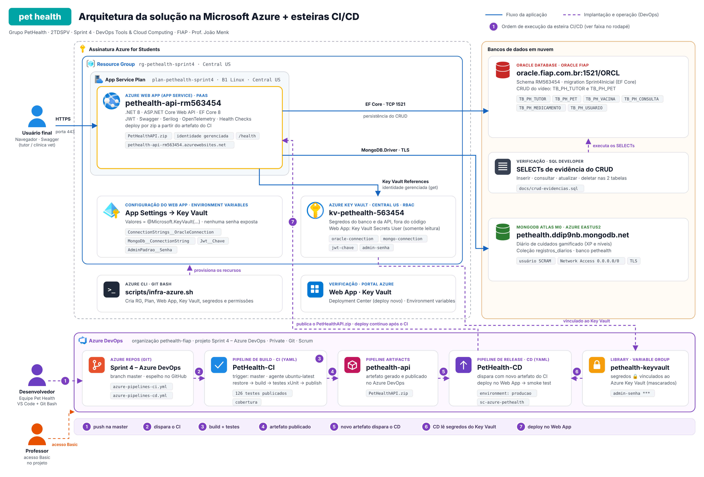
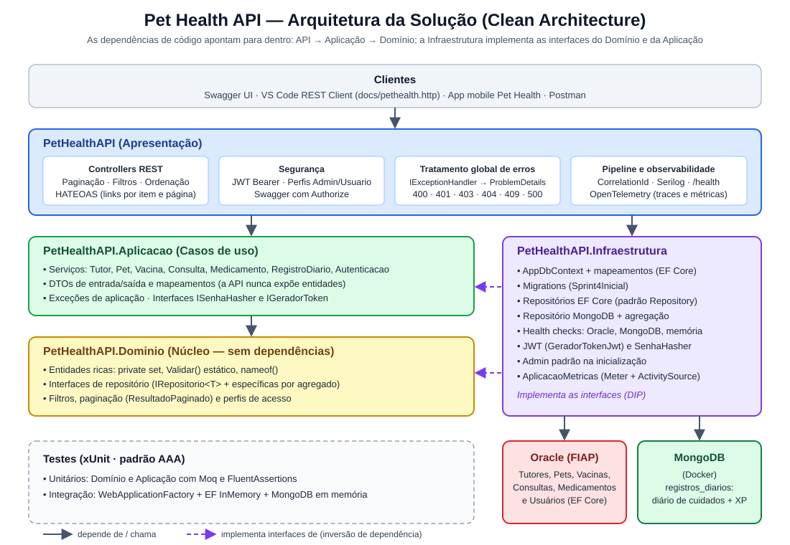
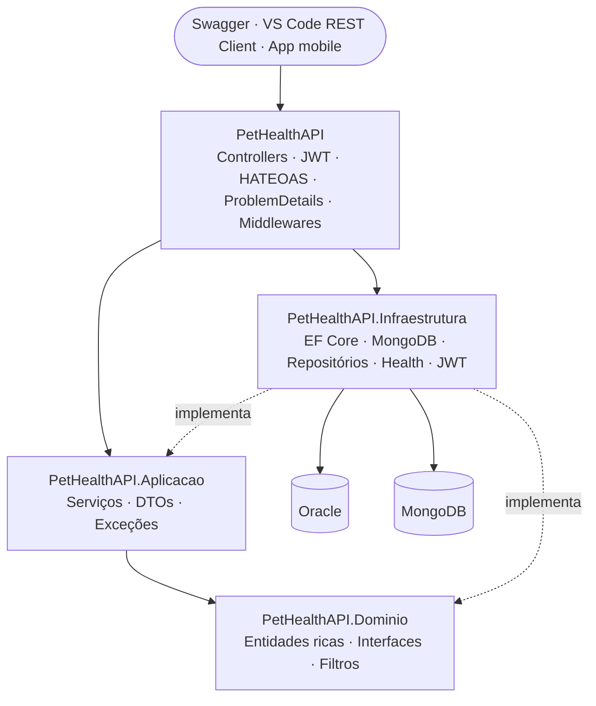
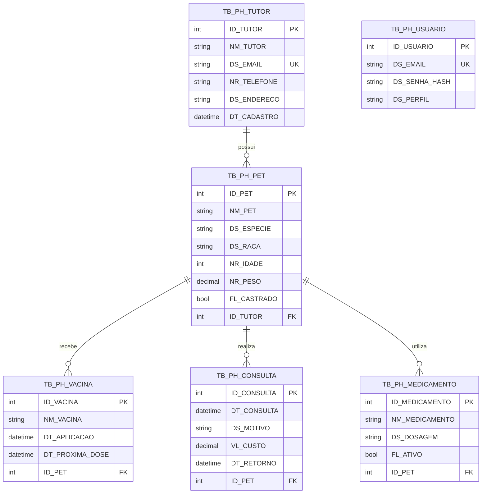

# 🐾 Pet Health API

> **FIAP — Challenge 2026 × CLYVO VET | Advanced Business Development with .NET — Sprint 4 (entrega final)**
> API RESTful em **.NET 8** com Clean Architecture, persistência **Oracle + MongoDB**, autenticação **JWT**, **HATEOAS**, observabilidade e testes automatizados.

---

## ☁️ DevOps Tools & Cloud Computing — Sprint 4 (CI/CD no Azure DevOps)

| Item | Link |
|---|---|
| Projeto no Azure DevOps | `https://dev.azure.com/pethealth-fiap/Sprint%204%20%E2%80%93%20Azure%20DevOps` *(substituir pelo link real)* |
| Repositório GitHub | `https://github.com/DVKevin/PetHealthAPI-DevOps-sp4` *(substituir)* |
| Vídeo (YouTube) | `https://youtu.be/XXXXXXXX` *(substituir)* |
| API publicada (Swagger) | `https://pethealth-api-rm563454.azurewebsites.net` |
| Health check | `https://pethealth-api-rm563454.azurewebsites.net/health` |

### 1. Descrição da solução

A **Pet Health API** é a API REST da plataforma Pet Health (Challenge FIAP 2026 × CLYVO VET). Ela centraliza a jornada de saúde do animal: cadastro de **tutores e pets**, **carteira de vacinação** com alerta de próxima dose, **histórico de consultas**, **medicamentos** e um **diário de cuidados gamificado** (XP e níveis). O acesso é protegido por **JWT** com perfis `Admin` e `Usuario`.

Nesta Sprint a aplicação é entregue com **CI/CD no Azure DevOps**: cada push na branch `master` compila, executa os testes automáticos e gera um artefato; o novo artefato dispara automaticamente o deploy no **Azure Web App**, que lê seus segredos do **Azure Key Vault** e persiste os dados no **Oracle (FIAP)**.

**Stack de tecnologias**

| Camada | Tecnologia |
|---|---|
| Aplicação | .NET 8 · ASP.NET Core Web API · Clean Architecture · EF Core 8 · JWT · Swagger · Serilog · OpenTelemetry |
| Banco de dados relacional (obrigatório) | **Oracle Database — Oracle FIAP** (`oracle.fiap.com.br:1521/ORCL`) |
| Banco NoSQL (diário de cuidados) | MongoDB Atlas M0 (cluster hospedado na Azure) |
| Testes automáticos | xUnit · Moq · FluentAssertions · WebApplicationFactory + EF Core InMemory · Coverlet (cobertura) |
| Repositório | Azure Repos (Git, branch `master`) + espelho no GitHub |
| CI/CD | Azure Pipelines (YAML): `azure-pipelines-ci.yml` e `azure-pipelines-cd.yml` |
| Artefato | Azure Pipelines Artifacts (`pethealth-api` → `PetHealthAPI.zip`) |
| Deploy (PaaS) | **Azure Web App** Linux · .NET 8 · App Service Plan B1 · região Central US |
| Segredos | **Azure Key Vault** (RBAC) + Managed Identity do Web App + Variable Group vinculado ao Key Vault |
| Infraestrutura | Azure CLI (`scripts/infra-azure.sh`) |

### 2. Diagrama da arquitetura + fluxo CI/CD



> Versão vetorial: [`docs/arquitetura-devops.svg`](docs/arquitetura-devops.svg). Linhas azuis = fluxo da aplicação; linhas roxas tracejadas = implantação e operação (DevOps); números = ordem da esteira CI/CD.

| # | O que acontece | Ferramenta |
|---|---|---|
| 1 | Desenvolvedor faz commit e `git push` na `master` (espelho no GitHub) | IDE + Git Bash → Azure Repos |
| 2 | O push na `master` dispara automaticamente a pipeline **PetHealth-CI** | Azure Pipelines (trigger CI) |
| 3 | Restore, build e **testes automáticos** (unitários + integração) com cobertura | Azure Pipelines · xUnit · Coverlet |
| 4 | Publish da API e **publicação do artefato** `pethealth-api` | Azure Pipelines Artifacts |
| 5 | O **novo artefato** dispara automaticamente a pipeline **PetHealth-CD** | Azure Pipelines (pipeline resource trigger) |
| 6 | O CD lê os segredos protegidos do Variable Group `pethealth-keyvault` | Library + Azure Key Vault |
| 7 | Deploy do `.zip` no Azure Web App via Service Connection (ARM) | Azure Pipelines → Azure Web App |
| 8 | O Web App lê os segredos no Key Vault via **Managed Identity** (Key Vault references) | Azure Key Vault |
| 9 | A API persiste o CRUD no Oracle FIAP | EF Core → Oracle |
| 10 | A API grava o diário de cuidados no MongoDB Atlas | MongoDB.Driver → Atlas |
| 11 | Usuário final consome a API por HTTPS (Swagger / REST) | Navegador / Postman |
| 12 | Equipe comprova a persistência com `SELECT` no banco | SQL Developer → Oracle |

### 3. Banco de dados em nuvem

**Oracle da FIAP** (opção aceita na Sprint). As tabelas `TB_PH_*` são criadas pela migration `Sprint4Inicial` (EF Core). Consultas de evidência do CRUD: [`docs/crud-evidencias.sql`](docs/crud-evidencias.sql).

No vídeo, o CRUD completo (inserir, consultar, atualizar e deletar) é feito em **duas tabelas**, `TB_PH_TUTOR` e `TB_PH_PET`, via Swagger no Azure Web App, com `SELECT` no Oracle depois de cada operação.

### 4. Projeto no Azure DevOps

| Campo | Valor |
|---|---|
| Project Name | `Sprint 4 – Azure DevOps` |
| Description | Projeto para entrega da Sprint 4 do professor João Menk + integrantes (RM - nome - turma) |
| Visibility | Private |
| Version control | Git |
| Work item process | Scrum |
| Professor | convidado com acesso **Basic** |

### 5. Pipelines CI/CD

**CI — `azure-pipelines-ci.yml` (pipeline `PetHealth-CI`)**

| Regra | Como foi atendida |
|---|---|
| Conectada ao repositório | Pipeline YAML criada a partir do Azure Repos do projeto |
| Dispara a cada alteração na `master` | `trigger: branches: include: [ master ]` |
| Execução de testes | `dotnet test` nos projetos `tests/**` (unitários + integração) com resultados e cobertura publicados |
| Geração e publicação do artefato | `dotnet publish` (zip) + `PublishPipelineArtifact` → artefato `pethealth-api` |

**CD — `azure-pipelines-cd.yml` (pipeline `PetHealth-CD`)**

| Regra | Como foi atendida |
|---|---|
| Dispara após novo artefato | `resources.pipelines` com `trigger` na pipeline `PetHealth-CI` (branch `master`); `trigger: none` para commits |
| Deploy em Azure Web App | Task `AzureWebApp@1` (Linux, `DOTNETCORE\|8.0`, zip deploy) no environment `producao` |
| Validação pós-deploy | Smoke test em `/health/live`, `/health` e login do administrador |

### 6. Variáveis de ambiente protegidas (usuários, senhas e tokens)

| Segredo | Onde fica | Como chega na aplicação |
|---|---|---|
| `oracle-connection` (usuário + senha do Oracle) | Azure Key Vault | App Setting `ConnectionStrings__OracleConnection` = Key Vault reference |
| `mongo-connection` (usuário + senha do Atlas) | Azure Key Vault | App Setting `MongoDb__ConnectionString` = Key Vault reference |
| `jwt-chave` (chave de assinatura dos tokens) | Azure Key Vault | App Setting `Jwt__Chave` = Key Vault reference |
| `admin-senha` (senha do administrador) | Azure Key Vault | App Setting `AdminPadrao__Senha` = Key Vault reference; usada no smoke test do CD via Variable Group (mascarada `***`) |

- Nenhum segredo está no Git: `appsettings.json` traz as chaves **vazias**; `appsettings.Testing.json` contém apenas valores fictícios usados pelos testes automatizados e **não é publicado** no Web App.
- O Web App acessa o Key Vault com **Managed Identity** e papel *Key Vault Secrets User* (somente leitura).
- O Azure DevOps acessa o Key Vault pelo **Variable Group `pethealth-keyvault`** (Library), vinculado ao cofre.

### 7. Como reproduzir

```bash
# 1. Infraestrutura (Git Bash, logado com az login)
bash scripts/infra-azure.sh

# 2. Tabelas no Oracle (uma vez)
dotnet ef database update --project src/PetHealthAPI.Infraestrutura --startup-project src/PetHealthAPI

# 3. Azure DevOps: Service Connection "sc-azure-pethealth", Variable Group "pethealth-keyvault",
#    pipelines "PetHealth-CI" (azure-pipelines-ci.yml) e "PetHealth-CD" (azure-pipelines-cd.yml)

# 4. Qualquer push na master executa CI -> artefato -> CD -> Web App
git push
```

### 8. Integrantes

| Nome | RM | Turma |
|---|---|---|
| Matheus Arazin de Oliveira | 556649 | 2TDSPV |
| Artur Pioli Silva | 565597 | 2TDSPV |
| Kevin Martins Campos | 563454 | 2TDSPV |
| Pedro Gabriel Claes | 566058 | 2TDSPV |

---

## 📑 Sumário

1. [Visão geral](#-visão-geral)
2. [Tecnologias](#-tecnologias)
3. [Arquitetura](#-arquitetura)
4. [Modelo de dados](#-modelo-de-dados)
5. [Endpoints](#-endpoints)
6. [Autenticação e autorização](#-autenticação-e-autorização)
7. [Paginação, filtros, ordenação e HATEOAS](#-paginação-filtros-ordenação-e-hateoas)
8. [Tratamento de erros](#-tratamento-de-erros)
9. [Monitoramento e observabilidade](#-monitoramento-e-observabilidade)
10. [Instalação e execução](#-instalação-e-execução)
11. [Testes](#-testes)
12. [Atendimento aos requisitos da Sprint 4](#-atendimento-aos-requisitos-da-sprint-4)
13. [Integrantes](#-integrantes)

---

## 🎯 Visão geral

O mercado pet sofre com a **fragmentação da jornada de saúde do animal**: tutores esquecem vacinas, perdem o histórico clínico e as clínicas perdem recorrência por falta de acompanhamento preventivo.

A **Pet Health API** centraliza essa jornada:

- **Tutores e pets** — cadastro completo, com vínculo tutor → pets;
- **Carteira de vacinação digital** — com alerta de próxima dose (`vencendoEmDias`);
- **Histórico clínico** — consultas com diagnóstico, tratamento, custo e retorno;
- **Medicamentos** — tratamentos ativos e encerrados;
- **Diário de cuidados gamificado (MongoDB)** — check-in diário (alimentação, hidratação, passeio, medicação), cada cuidado vale **10 XP** e a cada **100 XP** o pet sobe de nível.

A evolução das Sprints 1 a 3 foi consolidada nesta entrega: CRUD completo (Sprint 1), camadas de domínio e aplicação (Sprint 3), health checks, Serilog, OpenTelemetry e testes (Sprint 3) — agora reorganizados em **Clean Architecture**, com **JWT, HATEOAS, paginação e MongoDB**.

---

## 🧰 Tecnologias

| Tecnologia | Versão | Uso |
|---|---|---|
| ASP.NET Core | .NET 8 | API REST (Controllers) |
| Entity Framework Core + Oracle.EntityFrameworkCore | 8.0.11 / 8.21.121 | ORM e migrations no Oracle |
| MongoDB.Driver | 2.28.0 | Persistência NoSQL (diário de cuidados) |
| Microsoft.AspNetCore.Authentication.JwtBearer | 8.0.11 | Autenticação JWT |
| ASP.NET Core Identity (PasswordHasher) | .NET 8 | Hash de senhas (PBKDF2 + salt) |
| Swashbuckle (Swagger/OpenAPI) | 6.5.0 | Documentação interativa |
| Serilog.AspNetCore | 10.0.0 | Logging estruturado (texto + JSON) |
| OpenTelemetry | 1.18.0 | Traces e métricas |
| xUnit · Moq · FluentAssertions | 2.5.3 · 4.20.72 · 8.10.0 | Testes unitários |
| Microsoft.AspNetCore.Mvc.Testing · EF Core InMemory | 8.0.11 | Testes de integração |
| Docker Compose | — | MongoDB local |

---

## 🏗️ Arquitetura



> Versão em imagem: [`docs/arquitetura.png`](docs/arquitetura.png)

### Camadas e regra de dependência



| Projeto | Responsabilidade | Depende de |
|---|---|---|
| `PetHealthAPI.Dominio` | Entidades com regras de negócio (`private set`, `Validar()` estático, `nameof()`), interfaces de repositório, filtros e paginação | — (nenhum pacote) |
| `PetHealthAPI.Aplicacao` | Casos de uso (serviços), DTOs, mapeamentos, exceções de aplicação | Domínio |
| `PetHealthAPI.Infraestrutura` | EF Core/Oracle, MongoDB, repositórios concretos, health checks, JWT, hash de senha, métricas | Aplicação, Domínio |
| `PetHealthAPI` (API) | Controllers, autenticação, tratamento global de erros, middlewares, Swagger, composição (DI) | Aplicação, Infraestrutura |

### Princípios aplicados

- **SRP** — controllers só orquestram HTTP; regras ficam nas entidades; casos de uso nos serviços.
- **OCP / Template Method** — `RepositorioBase` implementa paginação e CRUD; cada repositório só define seus filtros e ordenação.
- **LSP / ISP** — `IRepositorio<TEntidade, TId, TFiltro>` genérico + interfaces específicas enxutas por agregado.
- **DIP** — serviços dependem de interfaces (`ITutorRepositorio`, `ISenhaHasher`, `IGeradorToken`); a Infraestrutura as implementa.
- **Injeção de dependência** — repositórios e serviços `Scoped`; JWT, hash e métricas `Singleton`; registro por camada (`AdicionarAplicacao`, `AdicionarInfraestrutura`).

### Estrutura de pastas

```
PetHealthAPI.sln
├── docker-compose.yml                  # MongoDB
├── docs/                               # diagrama, requisições de teste (.http), roteiro de testes
├── scripts/                            # limpeza de tabelas antigas e relatório de cobertura
├── src/
│   ├── PetHealthAPI.Dominio/           # Entidades, Interfaces, Filtros, Comum, Constantes
│   ├── PetHealthAPI.Aplicacao/         # Servicos, Dtos, Interfaces, Mapeamentos, Excecoes
│   ├── PetHealthAPI.Infraestrutura/    # Persistencia (DbContext, Configuracoes, Migrations),
│   │                                   # Repositorios, Mongo, Health, Seguranca, Observabilidade
│   └── PetHealthAPI/                   # Controllers, Hateoas, Middlewares, Tratamento, Configuracoes
└── tests/
    ├── PetHealthAPI.Tests.Unit/        # Dominio/ e Aplicacao/
    └── PetHealthAPI.Tests.Integration/ # Endpoints + Infraestrutura/ (factory, fakes)
```

---

## 🗄️ Modelo de dados

### Oracle (relacional — EF Core, migration `Sprint4Inicial`)



As exclusões de tutor e pet são em **cascata**. O histórico de migrations fica na tabela própria `__EFMigrationsHistory_PetHealth` (não interfere em outros projetos do mesmo usuário Oracle).

### MongoDB (NoSQL — coleção `registros_diarios`)

```json
{
  "_id": "ObjectId",
  "petId": 1,
  "data": "2026-09-29T00:00:00Z",
  "alimentacao": true,
  "hidratacao": true,
  "passeio": true,
  "medicacaoEmDia": false,
  "humor": "Feliz",
  "observacoes": "Passeou 40 minutos",
  "pontos": 30,
  "dataRegistro": "2026-09-29T18:10:00-03:00"
}
```

O vínculo com o pet é validado no Oracle antes de gravar no MongoDB. O total de XP é calculado por **agregação** (`$match` + `$group`).

---

## 🔌 Endpoints

Documentação interativa: **Swagger UI** em `http://localhost:5000` (raiz). Especificação OpenAPI exportada: [`docs/swagger.json`](docs/swagger.json).

🔒 = exige token JWT · 👑 = exige perfil **Admin**

### Autenticação — `/api/autenticacao`

| Método | Rota | Acesso | Descrição |
|---|---|---|---|
| POST | `/api/autenticacao/registrar` | público | Cadastra usuário (perfil `Usuario`) |
| POST | `/api/autenticacao/login` | público | Retorna o token JWT |
| GET | `/api/autenticacao/eu` | 🔒 | Dados do usuário do token |

### Tutores — `/api/tutores`

| Método | Rota | Acesso | Descrição |
|---|---|---|---|
| GET | `/api/tutores` | 🔒 | Lista paginada · filtros `nome`, `email` · ordena por `nome`, `email`, `dataCadastro` |
| GET | `/api/tutores/{id}` | 🔒 | Busca por ID |
| GET | `/api/tutores/{id}/pets` | 🔒 | Pets do tutor (paginado) |
| POST | `/api/tutores` | 🔒 | Cadastra |
| PUT | `/api/tutores/{id}` | 🔒 | Atualiza |
| DELETE | `/api/tutores/{id}` | 👑 | Remove (cascata) |

### Pets — `/api/pets`

| Método | Rota | Acesso | Descrição |
|---|---|---|---|
| GET | `/api/pets` | 🔒 | Lista paginada · filtros `nome`, `especie`, `raca`, `castrado`, `tutorId` · ordena por `nome`, `especie`, `idade`, `peso`, `dataCadastro` |
| GET | `/api/pets/{id}` | 🔒 | Busca por ID (links para tutor, vacinas, consultas, medicamentos, diário e pontos) |
| POST | `/api/pets` | 🔒 | Cadastra (tutor precisa existir) |
| PUT | `/api/pets/{id}` | 🔒 | Atualiza |
| DELETE | `/api/pets/{id}` | 👑 | Remove (cascata) |

### Vacinas — `/api/vacinas`

| Método | Rota | Acesso | Descrição |
|---|---|---|---|
| GET | `/api/vacinas` | 🔒 | Lista paginada · filtros `petId`, `nome`, `vencendoEmDias` · ordena por `nome`, `dataAplicacao`, `dataProximaDose` |
| GET | `/api/vacinas/{id}` | 🔒 | Busca por ID |
| POST | `/api/vacinas` | 🔒 | Registra |
| PUT | `/api/vacinas/{id}` | 🔒 | Atualiza |
| DELETE | `/api/vacinas/{id}` | 👑 | Remove |

### Consultas — `/api/consultas`

| Método | Rota | Acesso | Descrição |
|---|---|---|---|
| GET | `/api/consultas` | 🔒 | Lista paginada · filtros `petId`, `veterinario`, `dataInicio`, `dataFim`, `comRetornoPendente` · ordena por `dataConsulta`, `custo`, `dataRetorno` |
| GET | `/api/consultas/{id}` | 🔒 | Busca por ID |
| POST | `/api/consultas` | 🔒 | Registra |
| PUT | `/api/consultas/{id}` | 🔒 | Atualiza |
| DELETE | `/api/consultas/{id}` | 👑 | Remove |

### Medicamentos — `/api/medicamentos`

| Método | Rota | Acesso | Descrição |
|---|---|---|---|
| GET | `/api/medicamentos` | 🔒 | Lista paginada · filtros `petId`, `nome`, `ativo` · ordena por `nome`, `dataInicio`, `dataFim` |
| GET | `/api/medicamentos/{id}` | 🔒 | Busca por ID |
| POST | `/api/medicamentos` | 🔒 | Registra (nasce ativo) |
| PUT | `/api/medicamentos/{id}` | 🔒 | Atualiza |
| PATCH | `/api/medicamentos/{id}/encerrar` | 🔒 | Encerra o tratamento |
| DELETE | `/api/medicamentos/{id}` | 👑 | Remove |

### Diário de cuidados (MongoDB) — `/api/registros-diarios`

| Método | Rota | Acesso | Descrição |
|---|---|---|---|
| GET | `/api/registros-diarios` | 🔒 | Lista paginada · filtros `petId`, `dataInicio`, `dataFim` · ordena por `data`, `pontos` |
| GET | `/api/registros-diarios/{id}` | 🔒 | Busca por ObjectId (24 caracteres) |
| GET | `/api/registros-diarios/pets/{petId}/pontos` | 🔒 | XP total, nível e pontos para o próximo nível (agregação) |
| POST | `/api/registros-diarios` | 🔒 | Registra o check-in do dia |
| PUT | `/api/registros-diarios/{id}` | 🔒 | Atualiza (recalcula pontos) |
| DELETE | `/api/registros-diarios/{id}` | 👑 | Remove |

### Saúde da aplicação

| Método | Rota | Acesso | Descrição |
|---|---|---|---|
| GET | `/health` | público | Status detalhado: Oracle, MongoDB e memória |
| GET | `/health/live` | público | Liveness (processo no ar) |

---

## 🔐 Autenticação e autorização

- **JWT Bearer** assinado com HMAC-SHA256, contendo `sub`, `email`, `name`, `role` e `jti`; validade padrão de 60 minutos.
- Senhas armazenadas somente como **hash** (PasswordHasher do ASP.NET Core Identity).
- **Perfis**: o cadastro público cria `Usuario`; o `Admin` é criado automaticamente na inicialização da API.
- **Regras**: todos os endpoints de negócio exigem token; `DELETE` exige `Admin`.
- 401 e 403 retornam **ProblemDetails**, no mesmo formato dos demais erros.

**Credenciais do administrador:** e-mail `admin@pethealth.com`. A senha **não fica no repositório**: no Azure ela vem do Key Vault (`admin-senha`); localmente configure com `dotnet user-secrets set "AdminPadrao:Senha" "<senha>" --project src/PetHealthAPI` (e também `Jwt:Chave`, mínimo 32 caracteres).

**No Swagger:** execute `POST /api/autenticacao/login` → copie o `token` → clique em **Authorize** → cole apenas o token.

---

## 🔎 Paginação, filtros, ordenação e HATEOAS

Parâmetros comuns a todas as listagens:

| Parâmetro | Padrão | Descrição |
|---|---|---|
| `pagina` | 1 | Página (mínimo 1) |
| `tamanhoPagina` | 10 | Itens por página (máximo 50) |
| `ordenarPor` | id | Campo de ordenação (varia por recurso) |
| `direcao` | asc | `asc` ou `desc` |

Exemplo: `GET /api/pets?tutorId=1&pagina=1&tamanhoPagina=2&ordenarPor=nome`

```json
{
  "itens": [
    {
      "dados": { "id": 1, "nome": "Bidu", "especie": "Cão", "tutorId": 1, "nomeTutor": "Maria Oliveira" },
      "links": [
        { "href": "http://localhost:5000/api/pets/1", "rel": "self", "metodo": "GET" },
        { "href": "http://localhost:5000/api/pets/1", "rel": "atualizar", "metodo": "PUT" },
        { "href": "http://localhost:5000/api/pets/1", "rel": "remover", "metodo": "DELETE" },
        { "href": "http://localhost:5000/api/tutores/1", "rel": "tutor", "metodo": "GET" },
        { "href": "http://localhost:5000/api/vacinas?petId=1", "rel": "vacinas", "metodo": "GET" },
        { "href": "http://localhost:5000/api/registros-diarios/pets/1/pontos", "rel": "pontos", "metodo": "GET" }
      ]
    }
  ],
  "pagina": 1,
  "tamanhoPagina": 2,
  "totalItens": 3,
  "totalPaginas": 2,
  "links": [
    { "href": "http://localhost:5000/api/pets?tutorId=1&ordenarPor=nome&pagina=1&tamanhoPagina=2", "rel": "self", "metodo": "GET" },
    { "href": "http://localhost:5000/api/pets?tutorId=1&ordenarPor=nome&pagina=2&tamanhoPagina=2", "rel": "proxima", "metodo": "GET" },
    { "href": "http://localhost:5000/api/pets?tutorId=1&ordenarPor=nome&pagina=2&tamanhoPagina=2", "rel": "ultima", "metodo": "GET" }
  ]
}
```

Os links de página preservam os filtros da requisição. O HATEOAS também é **orientado a estado**: o link `encerrar` de um medicamento só aparece enquanto ele está ativo.

---

## ⚠️ Tratamento de erros

Um `IExceptionHandler` global converte qualquer exceção em **ProblemDetails (RFC 7807)**, com `correlationId` e `traceId`. Os controllers não têm `try/catch` de regra de negócio.

| Exceção | HTTP |
|---|---|
| `ArgumentException` (regra de domínio) | 400 |
| `CredenciaisInvalidasException` / token ausente ou inválido | 401 |
| Perfil sem permissão | 403 |
| `RecursoNaoEncontradoException` | 404 |
| `ConflitoException` (email duplicado) | 409 |
| Qualquer outra | 500 (detalhes só no log) |

```json
{
  "status": 404,
  "title": "Recurso não encontrado",
  "detail": "Pet com ID 999999 não encontrado.",
  "instance": "/api/pets/999999",
  "correlationId": "teste-roteiro-404",
  "traceId": "00-5b91b6f06bd7fa3d1290b3195cc597c8-3e20979a92997eb6-01"
}
```

---

## 🩺 Monitoramento e observabilidade

| Recurso | Implementação |
|---|---|
| **Health checks** | `IHealthCheck` próprios: `oracle` (EF Core `CanConnect`), `mongodb` (`ping`, Degraded se indisponível) e `memoria`. `/health` detalhado e `/health/live` |
| **Logging estruturado** | Serilog: console e `logs/app-AAAAMMDD.log` (template com `[CorrelationId]`) + `logs/app-AAAAMMDD.json` (JSON estruturado), rotação diária, log de cada requisição |
| **Correlation ID** | `CorrelationIdMiddleware`: reaproveita ou gera `X-Correlation-ID`, injeta no `LogContext`, no span e no header da resposta |
| **Tracing** | OpenTelemetry com instrumentação ASP.NET Core + span manual `CriarPetEndpoint` com tags `pet.*` |
| **Métricas** | `pets_criados_total` e `registros_diarios_criados_total` com tag `status` (`sucesso` / `erro_validacao`) |

A exportação no console é configurável em `appsettings.json` → `Observabilidade` (`ExportarTracesNoConsole`, `ExportarMetricasNoConsole`).

---

## 🚀 Instalação e execução

### Pré-requisitos

- [.NET SDK 8](https://dotnet.microsoft.com/download/dotnet/8.0)
- [Docker Desktop](https://www.docker.com/products/docker-desktop/) (MongoDB)
- Acesso a um banco **Oracle** (ex.: `oracle.fiap.com.br:1521/orcl`)
- Ferramenta do EF Core: `dotnet tool install --global dotnet-ef --version 8.0.11`

### Passo a passo

```powershell
# 1. Clonar
git clone https://github.com/PedroClaes/PetHealthAPI.git
cd PetHealthAPI

# 2. Connection string do Oracle (fica fora do repositório)
dotnet user-secrets set "ConnectionStrings:OracleConnection" "User Id=SEU_RM;Password=SUA_SENHA;Data Source=oracle.fiap.com.br:1521/orcl;" --project src\PetHealthAPI

# 3. Subir o MongoDB
docker compose up -d

# 4. Criar as tabelas no Oracle
dotnet ef database update --project src\PetHealthAPI.Infraestrutura --startup-project src\PetHealthAPI

# 5. Executar a API
dotnet run --project src\PetHealthAPI
```

Acesse **http://localhost:5000** (Swagger) e **http://localhost:5000/health**.

> Se o usuário Oracle já tiver as tabelas `TB_PH_*` de sprints anteriores, execute antes `scripts/limpar-tabelas-antigas.sql` no SQL Developer.

### Configurações (`src/PetHealthAPI/appsettings.json`)

| Seção | Chave | Descrição |
|---|---|---|
| `ConnectionStrings` | `OracleConnection` | Vazia no repositório — use `dotnet user-secrets` |
| `MongoDb` | `ConnectionString`, `NomeBanco`, `ColecaoRegistrosDiarios` | Padrão: `mongodb://localhost:27017`, `pethealth`, `registros_diarios` |
| `Jwt` | `Emissor`, `Audiencia`, `Chave`, `ExpiracaoMinutos` | `Chave` vazia no repositório — user-secrets (local) ou Key Vault (Azure), mín. 32 caracteres |
| `AdminPadrao` | `Nome`, `Email`, `Senha` | Administrador criado na inicialização (`Senha` vazia no repositório) |
| `Observabilidade` | `ExportarTracesNoConsole`, `ExportarMetricasNoConsole` | Saída do OpenTelemetry no console |

---

## 🧪 Testes

```powershell
dotnet test
```

| Projeto | Escopo | Ferramentas |
|---|---|---|
| `PetHealthAPI.Tests.Unit` | Entidades de domínio (Tutor, Pet, Vacina, Consulta, Medicamento, RegistroDiario, Usuario, paginação, validador de email) e todos os serviços de aplicação (Tutor, Pet, Vacina, Consulta, Medicamento, RegistroDiario, Autenticacao) | xUnit, Moq, FluentAssertions |
| `PetHealthAPI.Tests.Integration` | API real em memória: health checks, CRUD, paginação/HATEOAS, ProblemDetails, login, 401, 403 e 409 | WebApplicationFactory, EF Core InMemory, MongoDB em memória |

- Padrão **AAA** (Arrange, Act, Assert) e nomenclatura `Metodo_Cenario_ResultadoEsperado`.
- `[Theory]` + `[InlineData]` para entradas inválidas; `Verify(..., Times.Once/Never)` para comportamento.
- Os testes de integração **não dependem** de Oracle, Docker ou dados pré-existentes.

### Cobertura (Domínio e Aplicação)

```powershell
.\scripts\gerar-cobertura.ps1
```

Gera `coveragereport/index.html` e o resumo no terminal, filtrando as camadas `PetHealthAPI.Dominio` e `PetHealthAPI.Aplicacao`.

Resultado atual (126 testes: 110 unitários + 16 de integração):

| Métrica | Cobertura |
|---|---|
| Linhas | 78% (656 de 841) |
| Branches | 76% (175 de 230) |
| Métodos | 74% (268 de 362) |

### Roteiro de testes manuais (VS Code)

Veja [`docs/ROTEIRO-DE-TESTES.md`](docs/ROTEIRO-DE-TESTES.md) e o arquivo [`docs/pethealth.http`](docs/pethealth.http) (extensão REST Client): 28 requisições em sequência cobrindo todos os requisitos.

---

## ✅ Atendimento aos requisitos da Sprint 4

| Requisito | Onde está |
|---|---|
| Clean Architecture | 4 projetos em `src/` — ver [Arquitetura](#-arquitetura) |
| SOLID e Clean Code | Entidades ricas (`Dominio/Entidades`), `RepositorioBase`, interfaces segregadas, controllers enxutos |
| Injeção de dependência | `Configuracoes/InjecaoDependenciaAplicacao.cs`, `InjecaoDependenciaInfraestrutura.cs` |
| Tratamento global de exceções | `Tratamento/ManipuladorExcecoesGlobal.cs`, `EscritorProblemDetails.cs` |
| Swagger/OpenAPI | `Configuracoes/SwaggerConfiguracao.cs` + comentários XML · `docs/swagger.json` |
| Paginação, ordenação e filtros | `Dominio/Filtros`, `Persistencia/Extensoes/ConsultaExtensoes.cs` |
| HATEOAS | `Hateoas/`, `Controllers/ApiControllerBase.cs` |
| JWT | `Configuracoes/AutenticacaoConfiguracao.cs`, `Infraestrutura/Seguranca/` |
| EF Core + migrations (Oracle) | `Infraestrutura/Persistencia/Migrations` |
| MongoDB | `Infraestrutura/Mongo/`, `docker-compose.yml` |
| Padrão Repository | `Infraestrutura/Repositorios/`, `Mongo/RegistroDiarioRepositorioMongo.cs` |
| Health checks | `Infraestrutura/Health/`, `/health`, `/health/live` |
| Logging estruturado | `Program.cs` (Serilog), `Middlewares/CorrelationIdMiddleware.cs` |
| Testes unitários e de integração (AAA) | `tests/` |
| Cobertura de Domínio e Aplicação | `scripts/gerar-cobertura.ps1` |
| README e diagrama | este arquivo + `docs/arquitetura.svg` |

---

## 👥 Integrantes

| Nome | RM |
|---|---|
| Matheus Arazin de Oliveira | 556649 |
| Artur Pioli Silva | 565597 |
| Kevin Martins Campos | 563454 |
| Pedro Gabriel Claes | 566058 |

---

*Challenge 2026 — FIAP × CLYVO VET*
